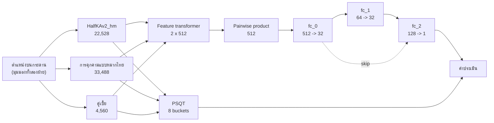

<div align="center">

  

  <h3>Platoo (ปลาทู)</h3>

  เอนจินวิเคราะห์หมากรุกไทย พัฒนาต่อยอดจาก Stockfish

  [English](README.en.md) | **ภาษาไทย**

</div>

## ภาพรวม

Platoo คือเอนจินหมากรุกไทยที่ใช้โปรโตคอล UCI ยึดตาม**กติกาการแข่งขันหมากรุกไทย พ.ศ. ๒๕๖๙** อย่างเคร่งครัด ทั้งการนับศักดิ์กระดาน นับศักดิ์หมาก และการเสมอจากการเดินซ้ำ ตัวเอนจิน hard fork มาจาก [Stockfish 19][stockfish-link] โดยตรง และปรับแก้เฉพาะส่วนที่จำเป็นสำหรับหมากรุกไทยเท่านั้น

- **กติกา:** ดูรายละเอียดได้ที่ [`makruk/docs/MAKRUK_RULES.md`](makruk/docs/MAKRUK_RULES.md) (ภาษาอังกฤษ) ระบบสร้างตาเดินผ่านการตรวจสอบเทียบกับ Fairy-Stockfish (`perft`) ส่วนการนับศักดิ์และการตัดสินเสมอจะยึดตามกติกาของไทยเป็นหลักในจุดที่ต่างออกไป
- **การประเมินตำแหน่ง:** ค่าเริ่มต้นใช้ระบบประเมินผลแบบดั้งเดิม (classical evaluation) ที่เขียนกฎขึ้นสำหรับหมากรุกไทยโดยเฉพาะ นอกจากนี้ยังรองรับการโหลดไฟล์โครงข่ายประสาทเทียม (NNUE) ของหมากรุกไทยได้ (ดูหัวข้อ [โครงข่ายประสาทเทียม](#nnue)) ทั้งนี้ โค้ดชุดนี้ไม่ได้แนบไฟล์น้ำหนักของโครงข่ายมาให้ และไม่จำเป็นต้องมีก็ใช้งานได้ทันที
- **การค้นหาตาเดิน:** ใช้ระบบค้นหาตาเดินของ Stockfish ร่วมกับระบบสร้างตาเดินหมากรุกไทย การตรวจจับการเสมอที่คำนึงถึงการนับศักดิ์ และการบริหารเวลาที่จูนมาให้เหมาะกับจังหวะเกมหมากรุกไทย

> [!CAUTION]
> **ความเก่ง:** repository นี้ไม่มีไฟล์ NNUE จึงเล่นด้วยการประเมินแบบ classical อย่างเดียว เป็นเอนจินตัวเดียวกับระดับ*ง่าย*และ*ปานกลาง*ที่ [play.platoomakruk.in.th](https://play.platoomakruk.in.th) (บนเว็บจำกัดจำนวนโหนดและสุ่มเลือกตาเดินเพิ่ม) ส่วนระดับ*โปร*และ*โปรแม็กซ์*ใช้ NNUE ของเรา (v8) ซึ่งไม่ได้เผยแพร่ และเก่งกว่ามาก

## จุดต่างสำคัญที่ทำให้ Platoo เหนือกว่าเอนจินรุ่นก่อน

### 1. เปลี่ยนจาก "Multi-Variant Abstraction" เป็น "Native Stockfish 19"

- **เอนจินเดิม (Fairy-Stockfish):** ต้องแบกโค้ดสำหรับหมากรุกจีน (Xiangqi), โชงิ (Shogi), จังกี (Janggi) และหมากรุกแฟนตาซีอีกมากมาย ทำให้ไม่สามารถอัปเกรดตาม Stockfish เวอร์ชันล่าสุดได้ทัน และมี Overhead ในการเช็กเงื่อนไขของแต่ละ Variant ตลอดเวลา
- **Platoo:** ตัด Variant อื่นทิ้งทั้งหมด แล้วนำสถาปัตยกรรมของ Stockfish 19 มาผ่าตัดเฉพาะส่วนที่เป็นหมากรุกไทย ทำให้ได้ความเร็วในการค้นหา (Search), ระบบจัดการเวลา (Time Management) และโครงสร้าง NNUE ระดับแนวหน้าของปี 2026 มาใช้แบบเต็มประสิทธิภาพ

### 2. ยกเครื่องระบบ "นับศักดิ์" เข้าไปใน Search Horizon โดยตรง

- ในเอนจินรุ่นเก่า การนับศักดิ์มักถูกมองเป็นเพียง "ตัวตัดสินผลแพ้ชนะตอนจบเกม" ทำให้ระหว่างที่เอนจินคิดล่วงหน้า (Search Tree) มักเกิดปัญหา Horizon Effect เช่น เอนจินคำนวณเจอทางรุกจนใน 25 ตา แต่ลืมไปว่าเหลือโควตานับศักดิ์อีกแค่ 18 ตาก็จะเสมอแล้ว
- Platoo ถอดตัวแปร `rule50` (กฎเสมอ 50 ตาของหมากรุกสากล) ออกทั้งหมด แล้วแทนที่ด้วย Counting Horizon ($h$) ซึ่งเป็นจำนวนตาที่เหลือจริงก่อนครบกำหนดนับศักดิ์ พร้อมฝังค่า $h$ ลงใน Transposition Table (TT) Key ทำให้เอนจินไม่นำคะแนนของตำแหน่งที่ "เหลือเวลาไล่เยอะ" มาปนกับตำแหน่งที่ "ใกล้หมดเวลานับศักดิ์"

### 3. โครงข่ายประสาทเทียม `MKNNv1` ที่เข้าใจวิถีหมากไทยจริงๆ

- เอนจินรุ่นก่อนใช้ฟีเจอร์โครงข่ายแบบกลางๆ ที่ไม่ได้แยกแยะความต่างเชิงเรขาคณิตของการคุกคามในหมากรุกไทย
- Platoo ดัดแปลงฟีเจอร์ `FullThreats` ของ Stockfish 19 ให้ตรงกับธรรมชาติของหมากไทย เช่น:
  - **การคุกคามแบบทางเดียว (Asymmetric Threats):** ในหมากรุกไทย โคน และ เรือ สามารถกิน เม็ด ในแนวตรงได้โดยที่เม็ดไม่สามารถกินสวนกลับในแนวตรงได้ Platoo จึงเก็บฟีเจอร์ `Khon -> Met` และ `Rua -> Met` ไว้ในโครงข่าย (ต่างจากหมากรุกสากลที่ควีนกินบิชอป/เรือสวนได้เสมอจึงตัดฟีเจอร์ซ้ำซ้อนออก)
  - **คู่โคนฝ่ายเดียวกัน:** เนื่องจากโคนเดินถอยหลังตรงไม่ได้ การผูกหรือขวางทางกันของโคนจึงไม่สมมาตร Platoo จึงปรับเงื่อนไข Semi-exclusion เพื่อไม่ให้ตัดข้อมูลสำคัญของคู่โคนทิ้ง
  - **โครงสร้างเบี้ย (`PP_3Wide`):** ใช้ฟีเจอร์คู่เบี้ยในรัศมี 3 แถวตั้งเพื่อจับรูปแบบการตั้งป้อมเบี้ย เบี้ยคู่ และเบี้ยซ้อน ซึ่งเป็นหัวใจสำคัญของหมากรุกไทย

### 4. การรับ-ส่งคำสั่ง UCI ที่ยืดหยุ่นขึ้น

- ใน Fairy-Stockfish และ cutechess หากส่งตาเลื่อนขั้นเบี้ย (หงายเบี้ย) เป็น `e5e6` โดยไม่เติมตัว `m` ต่อท้าย (`e5e6m`) เอนจินจะปฏิเสธและแจ้งว่าผิดกติกา (Illegal move) ทันที
- Platoo ใช้หลักการ Strict Output, Lenient Input คือเวลาเอนจินตอบกลับจะพิมพ์ `e5e6m` ตามมาตรฐานเสมอเพื่อไม่ให้ GUI รุ่นเก่าเอ๋อ แต่เวลาผู้ใช้งานหรือโปรแกรมภายนอกส่งตาเดินเข้ามา Platoo สามารถรับได้ทั้ง `e5e6m` และ `e5e6` (เพราะในหมากรุกไทย เบี้ยหงายได้เพียงอย่างเดียวคือเป็นเบี้ยหงาย/เม็ด ไม่มีการเลือกตัวหมากเหมือนหมากรุกสากล)

### 5. ใช้ฐานข้อมูลเผด็จหมาก (EGTB) ที่คิดกติกานับศักดิ์ไว้ในตัว

- Fairy-Stockfish ไม่มีฐานข้อมูลเผด็จหมากสำหรับหมากรุกไทย ตอนเหลือหมากน้อยจึงต้องคิดเอาเองทุกตำแหน่ง บางครั้งไล่จนไม่ทันนับ หรือยอมเสมอทั้งที่ชนะได้
- Platoo ใช้ฐานข้อมูลที่คำนวณไว้ครบทุกตำแหน่งที่มีหมากไม่เกิน 5 ตัว (145 ไฟล์ 10.5 GB) ค่าในฐานข้อมูลคิดการนับศักดิ์กระดานและนับศักดิ์หมากตามกติกา 2569 ไว้แล้ว เอนจินจึงรู้ทั้งผลแพ้ชนะ และรู้ว่าไล่จนทันนับหรือไม่
- ใช้ทั้งตอนคิดล่วงหน้า (ได้ค่าแน่นอนทันทีที่กินหมากจนเหลือไม่เกิน 5 ตัว) และที่ตำแหน่งปัจจุบัน (เลือกเฉพาะตาที่ดีที่สุดตามฐานข้อมูล คือชนะให้เร็วที่สุด หรือแพ้ให้ช้าที่สุด) พร้อมพิมพ์ `info string tb ...` ให้ GUI หรือบอทใช้ตัดสินใจขอเสมอหรือรับเสมอ
- ในการทดสอบของเรา การใช้ฐานข้อมูลทำให้แข็งขึ้นราว +8 ถึง +10 Elo ดูวิธีติดตั้งที่หัวข้อ [ฐานข้อมูลเผด็จหมาก](#egtb)

## การใช้งาน

Platoo สื่อสารผ่านโปรโตคอล UCI เหมือน Stockfish โปรแกรมกระดาน (GUI) อย่างเป็นทางการคือ [**Cute Makruk**](#cute-makruk) และยังใช้กับโปรแกรมหรือเครื่องมืออื่นที่รองรับเอนจินหมากรุกไทยแบบ UCI ได้ ตัวอย่างการสั่งงานโดยตรง:

```
uci
setoption name UCI_Variant value makruk
position startpos moves e3e4
go movetime 1000
```

ตัวเลือก (options) ที่แนะนำให้ปรับ: `Threads`, `Hash`, `MultiPV`, `Move Overhead`, `UCI_ShowWDL`

<a id="cute-makruk"></a>
## Cute Makruk: โปรแกรมกระดานอย่างเป็นทางการ

[**Cute Makruk**](https://github.com/kiraro33/cutemakruk) คือโปรแกรมกระดานและเครื่องมือจัดการแข่งขันอย่างเป็นทางการของ Platoo พัฒนาต่อจาก Cute Chess สำหรับหมากรุกไทยโดยเฉพาะ และตัดสินผลตาม **กติกาของสมาคมฯ พ.ศ. 2569** ในตัว: นับศักดิ์กระดาน นับศักดิ์หมาก ตำแหน่งซ้ำ 3 ครั้ง และขุนต่อขุน จบเกมได้เอง พร้อมแสดงการนับใต้นาฬิกา หน้าต่างโปรแกรมเป็นภาษาไทยเป็นค่าเริ่มต้น (เลือกภาษาอังกฤษได้)

- **ดาวน์โหลด:** [Cute Makruk releases](https://github.com/kiraro33/cutemakruk/releases) (Windows: โปรแกรมกระดานและบรรทัดคำสั่ง, Linux: บรรทัดคำสั่ง)
- **เพิ่ม Platoo:** เกม > เกมใหม่ > *เพิ่มเอนจิน...* แล้วเลือก `platoo.exe` ในหน้าตั้งค่าเอนจินจะมีช่อง *ไฟล์ net (EvalFile)* สำหรับ[โครงข่ายประสาทเทียม](#nnue) และ *ตารางหมากจบ (TBPath)* สำหรับ[ฐานข้อมูลเผด็จหมาก](#egtb)
- **แข่งเอนจิน** ด้วยโปรแกรมบรรทัดคำสั่ง `cutemakruk` (ตัวเลือกเหมือน cutechess-cli):

```
cutemakruk -engine name=Platoo cmd=platoo.exe "option.EvalFile=<net>.nnue" -engine name=Other cmd=other.exe -each proto=uci tc=10+0.1 "option.Move Overhead=100" -games 2 -rounds 100 -repeat -maxmoves 400 -pgnout games.pgn
```

## การคอมไพล์ (build)

ต้องติดตั้ง `make` และคอมไพเลอร์ C++17 (GCC หรือ Clang) ถ้าใช้ Windows ให้รันผ่าน [MSYS2](https://www.msys2.org/) (หน้าต่าง MinGW64) จากนั้นเข้าไปที่โฟลเดอร์ `src/` แล้วสั่ง:

```
make -j profile-build    # ไฟล์ไบนารีที่เร็วที่สุด (profile-guided)
make -j build            # build แบบปกติ (ใช้เมื่อ profile-build ไม่ผ่าน)
```

ทดสอบด้วยคำสั่ง `./platoo bench` (บน Windows ใช้ `platoo.exe bench`) ถ้าขึ้น `Nodes searched: 1949398` แสดงว่าพร้อมใช้งาน

<a id="egtb"></a>

## ฐานข้อมูลเผด็จหมาก (endgame tables)

Platoo ใช้ฐานข้อมูลเผด็จหมากที่คำนวณไว้ครบทุกตำแหน่งที่มีหมาก **ไม่เกิน 5 ตัว** (นับรวมขุน) ตามกติกาการนับศักดิ์ 2569 ได้ มีไฟล์ `.mktbe` 145 ไฟล์ ขนาดรวม 10.5 GB ดาวน์โหลดได้จาก Hugging Face [`kiraro33/platoo-egtb-5men`](https://huggingface.co/datasets/kiraro33/platoo-egtb-5men) ส่วนโปรแกรมสร้างไฟล์และรูปแบบไฟล์อยู่ที่ [`kiraro33/platoo-egtb`](https://github.com/kiraro33/platoo-egtb)

คอมไพล์ด้วย `tb=yes` (ต้องมี zstd: ใน MSYS2 ใช้ `pacman -S mingw-w64-x86_64-zstd` บน Debian/Ubuntu ใช้ `apt install libzstd-dev`) แล้วบอกเอนจินว่าไฟล์อยู่ที่โฟลเดอร์ไหน

```
make -j profile-build tb=yes
setoption name TBPath value <โฟลเดอร์>      (หลายโฟลเดอร์คั่นด้วย ';')
```

เมื่อมีฐานข้อมูล เอนจินจะเล่นเผด็จหมากเหล่านี้ได้สมบูรณ์ รวมถึงในการค้นหาด้วย และถ้าตำแหน่งปัจจุบันอยู่ในฐานข้อมูลจะพิมพ์ `info string tb <win|draw|loss> <ply> ...` ถ้าไม่ตั้ง `TBPath` (ค่าเริ่มต้น) ผลทุกอย่างเหมือนเดิม และ `bench` ไม่เปลี่ยน

<a id="nnue"></a>

## โครงข่ายประสาทเทียม (NNUE)

ถ้าคอมไพล์ด้วย `nnue=yes` เอนจินจะประเมินกระดานด้วยโมเดลหมากรุกไทยชื่อ **MKNNv1** ซึ่งนำโครงสร้าง SFNNv16 ของ Stockfish 19 มาปรับฟีเจอร์การคุกคามให้เข้ากับหมากไทย และใช้เลเยอร์แรกขนาด 512

เอนจินไม่ได้แถมไฟล์โมเดลมาให้ ต้องเตรียมไฟล์ `platoo-<sha12>.nnue` ของตัวเอง แล้วโหลดด้วยคำสั่ง `setoption name EvalFile value <path>` (ไฟล์ NNUE ของ Fairy-Stockfish และของหมากรุกสากลใช้ไม่ได้) ดูโครงสร้าง ดัชนีฟีเจอร์ รูปแบบไฟล์ และวิธีเทรนโมเดลได้ที่ [`makruk/docs/NNUE_ARCHITECTURE.md`](makruk/docs/NNUE_ARCHITECTURE.md) (ภาษาอังกฤษ)



เลเยอร์ซ่อน (`fc_0` ถึง `fc_2`) แบ่งเป็น 8 ชุด ระบบจะเลือกใช้ตามจำนวนตัวหมากที่เหลืออยู่บนกระดาน

## การทดสอบ

โฟลเดอร์ `makruk/tests/` เก็บชุดตำแหน่งทดสอบ `perft`, ชุดเปิดหมาก และชุดทดสอบกติกา (`makruk/tools/perft_diff.py`, `makruk/tools/rule_tests.py`) การเทียบค่า `perft` ต้องมีไฟล์ไบนารีของ Fairy-Stockfish โดยตั้งตัวแปร `MAKRUK_EXTERNAL` ให้ชี้ไปยังโฟลเดอร์ที่เก็บไฟล์นั้น

**การแข่งและการทดสอบความแข็ง** ของ Platoo (SPRT, net กับ net, แข่งกับ Fairy-Stockfish) ทั้งหมดเล่นด้วยโปรแกรมบรรทัดคำสั่งของ [Cute Makruk](#cute-makruk) ซึ่งตัดสินผลตามกติกา 2569 ในตัว คะแนนจึงไม่ต้องนำมาตัดสินใหม่ภายหลัง และโค้ดกติกาของ Cute Makruk ผ่านชุดทดสอบกติกา 196 กรณีชุดเดียวกัน และการตรวจกับเกมสุ่มหลายพันเกม

## เงื่อนไขการใช้งาน

Platoo เป็นซอฟต์แวร์เสรี เผยแพร่ภายใต้สัญญาอนุญาต [**GNU General Public License version 3**](Copying.txt) (GPL v3) เช่นเดียวกับ Stockfish คุณสามารถนำไปใช้งาน ศึกษา แก้ไข และแจกจ่ายต่อได้ แต่ถ้าแจกจ่ายไฟล์โปรแกรม (binaries) ออกไป ต้องเปิดเผยซอร์สโค้ดฉบับเต็มรวมถึงส่วนที่แก้ไขภายใต้สัญญาอนุญาต GPL v3 ด้วย

## กิตติกรรมประกาศ

- **Stockfish** และทีมผู้พัฒนา ([AUTHORS](AUTHORS)): ระบบค้นหาตาเดินและโค้ดส่วนใหญ่ของ Platoo มาจากผลงานของทีมนี้ ดูเพิ่มเติมได้ที่ [stockfishchess.org][stockfish-link]
- **Fairy-Stockfish** โดย Fabian Fichter และผู้ร่วมพัฒนา (GPL v3): ต้นแบบอ้างอิงสำหรับระบบสร้างตาเดินหมากรุกไทย
- **Cute Chess** โดย Ilari Pihlajisto, Arto Jonsson และผู้ร่วมพัฒนา (GPL v3): ต้นแบบของ [Cute Makruk](https://github.com/kiraro33/cutemakruk) โปรแกรมกระดานและเครื่องมือแข่งของ Platoo

[stockfish-link]: https://stockfishchess.org
