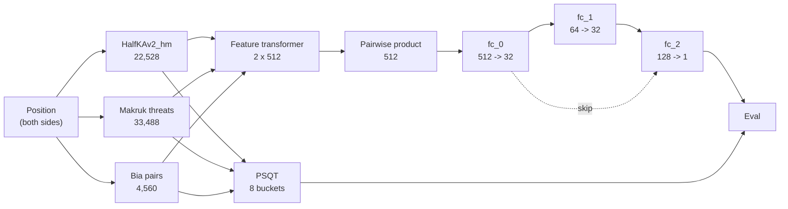

<div align="center">

  

  <h3>Platoo (ปลาทู)</h3>

  A Thai Makruk (หมากรุกไทย) analysis engine, derived from Stockfish.

</div>

## Overview

Platoo is a UCI engine for **Makruk** under the **Thai association rules 2569**
(กติกาการแข่งขันหมากรุกไทย พ.ศ. ๒๕๖๙), including the counting rules (นับศักดิ์กระดาน,
นับศักดิ์หมาก) and the repetition draw. It is a hard fork of
[Stockfish 19][stockfish-link], changed only where Makruk needs it.

- **Rules:** [`makruk/docs/MAKRUK_RULES.md`](makruk/docs/MAKRUK_RULES.md). Move generation
  is checked against Fairy-Stockfish (perft); counting and draws follow the Thai rules where
  they differ from Fairy-Stockfish.
- **Evaluation:** the default build uses the **classical (hand-written) Makruk evaluation**.
  Platoo can also load a Makruk NNUE (see [Neural network](#neural-network)); no network
  weights are included in this repository, and none are needed.
- **Search:** Stockfish's search, with Makruk move generation, counting-aware draw
  detection and Makruk-tuned time management.

## What is different

Fairy-Stockfish plays dozens of variants from one code base and is our reference for Makruk move
generation. Platoo has a narrower goal: Makruk only, as close to current Stockfish as possible.

1. **Stockfish 19, Makruk only.** Platoo is a hard fork of Stockfish 19, not of
   Fairy-Stockfish. Only what Makruk needs was changed (board, move generation, counting,
   evaluation), and chess-only code (castling, en passant, Syzygy) was removed. Search, time
   management and NNUE inference are Stockfish 19's, with Makruk-tuned parameters and a
   sudden-death time model for long Makruk endgames. No per-variant rule checks run in the
   search.

2. **Counting inside the search.** The 2569 counting rules (นับศักดิ์กระดาน, นับศักดิ์หมาก) are
   part of the position, not only a game-end check. Stockfish's 50-move rule does not exist;
   `rule50` is only the repetition window. The search uses the **counting horizon** *h*, the
   plies left before the counting draw:
   - a mate that cannot be delivered within *h* is not scored as a win (for example, a mate in
     25 moves with 18 moves of count left is a draw), also for scores read from the
     transposition table;
   - close to the counting draw the transposition table gives no cutoffs;
   - in the last 86 plies of a count *h* is part of the transposition-table key (in 8-ply
     buckets), so positions with very different counts left do not share entries.

3. **Makruk threat features (MKNNv1).** With `nnue=yes`, Stockfish 19's `FullThreats` input
   features are redefined for Makruk geometry. A pair "A attacks B" is left out only when B
   always attacks A back, so the Makruk table differs from chess: Khon → Met and Rua → Met are
   kept (a Met never attacks straight back), Met → Khon is left out (the Khon always attacks
   the Met back diagonally), and two Khon of the same colour are not treated as attacking each
   other back (a Khon steps forward but not backward). The Bia-pair features (`PP_3Wide`,
   adjacent files) are kept for Bia chains, rams and doubled or isolated Bia. No net is
   included; see [Neural network](#neural-network).

4. **Strict output, lenient input.** Platoo always writes a promotion with the `m` suffix
   (`e5e6m`), as Fairy-Stockfish and cutechess require. It accepts `e5e6m`, `e5e6M` and `e5e6`,
   because a Bia can only promote to a Met.

5. **GUI-friendly results.** The `d` command prints the counting state and the game result
   (`Counting:` and `Result:` lines). `go` on a finished position answers at once: a mated or
   stalemated side gets `bestmove (none)`, and a rule draw with legal moves reports
   `info string result 1/2-1/2 counting` (or `repetition`, `bare-khuns`) before a normal search. Repetition is
   3-fold on the board alone (the side to move is ignored), and Khun vs Khun is the only
   material draw.

Move generation is checked against Fairy-Stockfish with perft, and the rules with 196 test
cases in `makruk/tests/rules`.

## Using Platoo

Platoo speaks UCI, like Stockfish. Use it from any GUI or tool that supports Makruk, for
example cutechess with `-variant makruk`:

```
uci
setoption name UCI_Variant value makruk
position startpos moves e3e4
go movetime 1000
```

Useful options: `Threads`, `Hash`, `MultiPV`, `Move Overhead`, `UCI_ShowWDL`.

## Compiling

You need `make` and a C++17 compiler (GCC or Clang). On Windows use
[MSYS2](https://www.msys2.org/) (MinGW64 shell). From `src/`:

```
make -j profile-build    # fastest binary (profile-guided)
make -j build            # plain build, if profile-build fails
```

Check the build with `./platoo bench` (`platoo.exe bench` on Windows): it should print `Nodes searched: 1949398`.

## Neural network

With `nnue=yes` Platoo evaluates with a Makruk NNUE, **MKNNv1**: Stockfish 19's SFNNv16
layout with Makruk threat features and a 512-wide first layer. No net is shipped; you need
your own `platoo-<sha12>.nnue` file (`setoption name EvalFile value <path>`). Architecture,
feature indices, file format and how to train a compatible net:
[`makruk/docs/NNUE_ARCHITECTURE.md`](makruk/docs/NNUE_ARCHITECTURE.md).



The hidden layers (`fc_0` to `fc_2`) come in 8 stacks, chosen by the number of pieces on the
board.

## Tests

`makruk/tests/` holds perft positions, opening suites and rule tests
(`makruk/tools/perft_diff.py`, `makruk/tools/rule_tests.py`). The perft comparison needs a
Fairy-Stockfish binary; point `MAKRUK_EXTERNAL` at the folder that holds it.

## Terms of use

Platoo is free software, distributed under the
[**GNU General Public License version 3**](Copying.txt) (GPL v3), like Stockfish. You may
use, study, modify and redistribute it; if you distribute binaries, you must also make the
full source code (including your changes) available under the GPL v3.

## Acknowledgements

- **Stockfish** and the Stockfish developers ([AUTHORS](AUTHORS)): Platoo's search and most
  of its code are theirs. Visit [stockfishchess.org][stockfish-link].
- **Fairy-Stockfish** by Fabian Fichter and contributors (GPL v3): our reference for Makruk
  move generation.

[stockfish-link]: https://stockfishchess.org
