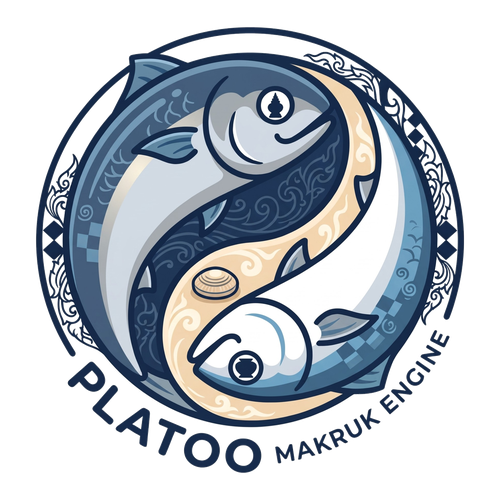
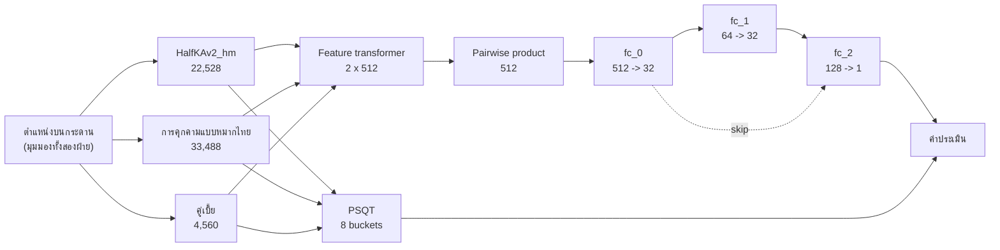

<div align="center">

  

  <h3>Platoo (ปลาทู)</h3>

  เอนจินวิเคราะห์หมากรุกไทย (Makruk) พัฒนาต่อจาก Stockfish

  [English](README.md) | **ภาษาไทย**

</div>

## ภาพรวม

Platoo เป็นเอนจิน UCI สำหรับ**หมากรุกไทย** ตาม**กติกาการแข่งขันหมากรุกไทย พ.ศ. ๒๕๖๙**
รวมถึงกติกาการนับศักดิ์ (นับศักดิ์กระดาน, นับศักดิ์หมาก) และการเสมอเพราะเดินซ้ำ Platoo เป็น
hard fork ของ [Stockfish 19][stockfish-link] โดยแก้เฉพาะส่วนที่หมากรุกไทยจำเป็นต้องใช้

- **กติกา:** [`makruk/docs/MAKRUK_RULES.md`](makruk/docs/MAKRUK_RULES.md) (ภาษาอังกฤษ)
  การสร้างตาเดิน เราได้ตรวจเทียบกับ Fairy-Stockfish ด้วย perft ส่วนการนับศักดิ์และการเสมอยึดกติกาไทย
  ในจุดที่ต่างจาก Fairy-Stockfish (Stockfish 19 ไม่มีการนับศักดิ์)
- **การประเมินตำแหน่ง:** build มาตรฐานใช้**การประเมินแบบ classical (เขียนกฎเอง ไม่ใช้ neural network)** แต่ก็ยังสามารถ
  โหลด NNUE ของหมากรุกไทยได้ด้วย (ดู [โครงข่ายประสาทเทียม](#nnue)) แต่
  repository นี้ไม่มีไฟล์ NNUE มาให้ ท่านต้องสร้างเอง
- **การค้นหา:** ใช้ search ของ Stockfish ร่วมกับกฎตาเดินของหมากรุกไทย ตรวจการนับศักดิ์
  และการจัดเวลาที่ปรับมาสำหรับหมากรุกไทยโดยเฉพาะ

## จุดที่แตกต่าง

เอนจินอย่าง Fairy-Stockfish เล่นหมากรุกได้หลายสิบแบบจากโค้ดชุดเดียว ส่วน Platoo มีเป้าหมายที่เฉพาะเจาะจงกว่า
  คือรองรับหมากรุกไทยอย่างเดียว และพัฒนาใกล้เคียงกับ Stockfish รุ่นปัจจุบันให้มากที่สุด

1. **Stockfish 19 สำหรับหมากรุกไทยโดยเฉพาะ** Platoo fork มาจาก Stockfish 19 ไม่ได้ fork
   มาจาก Fairy-Stockfish แก้เฉพาะสิ่งที่หมากรุกไทยต้องการ (กระดาน, การสร้างตาเดิน, การนับศักดิ์,
   การประเมินตำแหน่ง) และตัดโค้ดที่ใช้เฉพาะหมากรุกสากลออก (การเข้าป้อม, en passant,
   Syzygy) ส่วน search, การจัดเวลา และ NNUE inference เป็นของ Stockfish 19 โดยปรับพารามิเตอร์
   ให้เข้ากับหมากรุกไทย และมีการจัดเวลาแบบ sudden death สำหรับช่วงท้ายเกมที่ยาว ไม่มีการตรวจกติกา
   ของ variant อื่นระหว่าง search

2. **การนับศักดิ์ที่รวมอยู่ใน search** กติกาการนับศักดิ์ ๒๕๖๙ (นับศักดิ์กระดาน, นับศักดิ์หมาก) เป็นส่วน
   หนึ่งของตำแหน่งบนกระดาน ไม่ได้เป็นแค่การตัดสินผลตอนจบเกม กฎเสมอ 50 ตาของหมากรุกสากล
   ไม่มีใน Platoo ตัวแปร `rule50` เหลือไว้ใช้ย้อนดูการเดินซ้ำเท่านั้น search ใช้
   **counting horizon** *h* คือจำนวน ply (ครึ่งตา) ที่เหลือก่อนครบการนับ:
   - การรุกจนที่ทำไม่ทันภายใน *h* ไม่นับเป็นชนะ (เช่น เจอทางรุกจนใน 25 ตา แต่เหลือนับอีก 18 ตา
     จะถือว่าเสมอ) รวมถึงคะแนนที่อ่านจาก transposition table ด้วย
   - เมื่อใกล้ครบการนับ จะไม่ตัด search ด้วยค่าจาก transposition table
   - ในช่วง 86 ply สุดท้ายของการนับ ค่า *h* เป็นส่วนหนึ่งของ key ใน transposition table
     (เป็นกลุ่มละ 8 ply) ตำแหน่งที่เหลือนับต่างกันมากจึงไม่ใช้ข้อมูลร่วมกัน

3. **feature Threats ของหมากรุกไทยโดยเฉพาะ (MKNNv1)** เมื่อ build ด้วย `nnue=yes` feature
   `FullThreats` ของ Stockfish 19 ถูกนิยามใหม่ตามวิธีเดินของหมากไทย คู่ "A คุกคาม B" จะถูกตัด
   ทิ้งเฉพาะเมื่อ B คุกคาม A กลับได้เสมอ ตารางของหมากรุกไทยจึงต่างจากหมากรุกสากล: เก็บ
   โคน → เม็ด และ เรือ → เม็ด ไว้ (เม็ดกินสวนในแนวตรงไม่ได้), ตัด เม็ด → โคน ออก (โคนกินเม็ด
   สวนในแนวทแยงได้เสมอ) และโคนสีเดียวกันสองตัวไม่ถือว่าคุกคามกันและกัน (โคนเดินตรงไปหน้า
   ได้แต่ถอยตรงไม่ได้)

4. **ตาเลื่อนขั้นเบี้ยแบบ UCI: ส่งออกเคร่งครัด รับเข้ายืดหยุ่น** Platoo เขียนตาเลื่อนขั้นเบี้ยพร้อม `m` ต่อท้ายเสมอ
   (`e5e6m`) ตามที่ Fairy-Stockfish และ cutechess ต้องการ และรับได้ทั้ง `e5e6m`, `e5e6M` และ
   `e5e6` เพราะเบี้ยหงายได้เป็นเม็ดอย่างเดียว


## การใช้งาน

Platoo สื่อสารด้วย UCI เหมือน Stockfish ใช้ได้กับ GUI หรือโปรแกรมที่รองรับหมากรุกไทย เช่น
cutechess ด้วย `-variant makruk`:

```
uci
setoption name UCI_Variant value makruk
position startpos moves e3e4
go movetime 1000
```

ตัวเลือกที่ใช้บ่อย: `Threads`, `Hash`, `MultiPV`, `Move Overhead`, `UCI_ShowWDL`

## การ build

ต้องมี `make` และ compiler C++17 (GCC หรือ Clang) บน Windows ใช้
[MSYS2](https://www.msys2.org/) (shell MinGW64) สั่งจากโฟลเดอร์ `src/`:

```
make -j profile-build    # binary ที่เร็วที่สุด (profile-guided)
make -j build            # build ธรรมดา ถ้า profile-build ไม่ผ่าน
```

ตรวจผลการ build ด้วย `./platoo bench` (บน Windows ใช้ `platoo.exe bench`) ต้องได้
`Nodes searched: 1949398`

<a id="nnue"></a>

## โครงข่ายประสาทเทียม (NNUE)

เมื่อ build ด้วย `nnue=yes` Platoo จะประเมินตำแหน่งด้วย NNUE ของหมากรุกไทย **MKNNv1**:
โครงสร้าง SFNNv16 ของ Stockfish 19 ที่ใช้ feature การคุกคามแบบหมากรุกไทย และ layer แรกกว้าง
512 repository นี้ไม่มีไฟล์ net ต้องใช้ไฟล์ `platoo-<sha12>.nnue` ของคุณเอง
(`setoption name EvalFile value <path>`) รายละเอียดโครงสร้าง, index ของ feature, รูปแบบไฟล์
และวิธี train net ที่ใช้ร่วมกันได้อยู่ใน
[`makruk/docs/NNUE_ARCHITECTURE.md`](makruk/docs/NNUE_ARCHITECTURE.md) (ภาษาอังกฤษ)



layer ซ่อน (`fc_0` ถึง `fc_2`) มี 8 ชุด เลือกใช้ตามจำนวนหมากบนกระดาน

## การทดสอบ

`makruk/tests/` มีตำแหน่งสำหรับ perft, ชุดเปิดเกม และ test กติกา
(`makruk/tools/perft_diff.py`, `makruk/tools/rule_tests.py`) การเทียบ perft ต้องมีไฟล์
Fairy-Stockfish ตั้ง `MAKRUK_EXTERNAL` ให้ชี้ไปที่โฟลเดอร์ที่เก็บไฟล์นั้น

## เงื่อนไขการใช้งาน

Platoo เป็นซอฟต์แวร์เสรี เผยแพร่ภายใต้
[**GNU General Public License version 3**](Copying.txt) (GPL v3) เช่นเดียวกับ Stockfish
ใช้งาน ศึกษา แก้ไข และเผยแพร่ต่อได้ ถ้าแจกจ่าย binary ต้องเปิด source code ทั้งหมด
(รวมส่วนที่แก้ไข) ภายใต้ GPL v3 ด้วย

## ขอขอบคุณ

- **Stockfish** และทีมพัฒนา Stockfish ([AUTHORS](AUTHORS)): search และโค้ดส่วนใหญ่ของ Platoo
  เป็นผลงานของพวกเขา เยี่ยมชมได้ที่ [stockfishchess.org][stockfish-link]
- **Fairy-Stockfish** โดย Fabian Fichter และผู้ร่วมพัฒนา (GPL v3): ตัวอ้างอิงด้านการสร้างตาเดิน
  ของหมากรุกไทยของเรา

[stockfish-link]: https://stockfishchess.org
