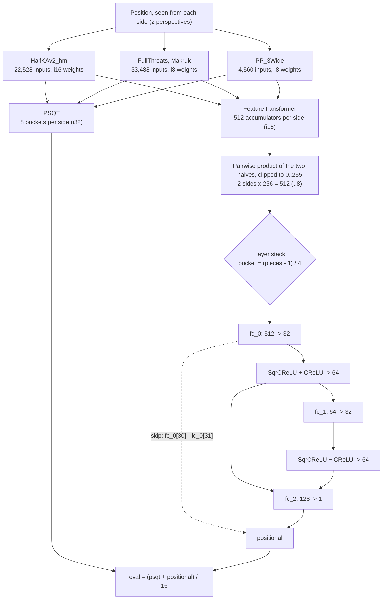

# Platoo NNUE architecture (MKNNv1)

This document describes the neural-network evaluation that Platoo can load with `nnue=yes`:
the network layout, the Makruk input features, the net file format and what a trainer must do
to write compatible nets. **No network weights are distributed with Platoo**, and the default
build (`nnue=no`) uses the classical evaluation.

Contents: §1 Summary · §2 Network · §3 Input features · §4 Net file format · §5 Using a net ·
§6 Training a compatible net

---

## 1. Summary

| Topic | MKNNv1 |
|---|---|
| Base | Stockfish 19's **SFNNv16** layout, unchanged apart from the threat features and the sizes below |
| PSQ features | `HalfKAv2_hm`, 22,528 inputs (unchanged from chess) |
| Threat features | `FullThreats` with Makruk attacks and a Makruk target table, **33,488** inputs |
| Pawn pairs | `PP_3Wide`, 4,560 inputs (unchanged from chess) |
| First layer | **L1 = 512** |
| Hidden layers | L2 = 32, L3 = 32, 8 layer stacks, 8 PSQT buckets |
| File | SF19 layout, `Version = 0x4D4B4E31` ("MKN1"), threat hash `0x4D4B5448` ("MKTH"); chess nets are rejected |
| File name | `platoo-<first 12 hex digits of the file's SHA-256>.nnue` |
| Trainer | nnue-pytorch at commit `aa2fff2` (the last SFNNv16 commit) with the Makruk changes of §6 |



---

## 2. Network

Inference is Stockfish 19's code (`src/nnue/`); only the feature definitions, `L1` and the file
constants differ.

### 2.1 Inputs (`src/nnue/features/`)

| Family | Class | Dimensions | Weights | Max active / perspective |
|---|---|---|---|---|
| Khun-bucketed piece-square, mirrored | `HalfKAv2_hm` | 64 sq × 11 planes × 32 Khun buckets = **22,528** | i16 | 32 |
| Attacker → attacked pairs | `FullThreats` | **33,488** | i8 | 256 |
| Bia pairs in a 3-file band | `PP_3Wide` | 96·95/2 = **4,560** | i8 | 256 |

Threat and pawn-pair weights live in one i8 block; pawn-pair index *k* is row `33488 + k`.
Each family also has 8 PSQT columns (i32), summed into a material-like term
`(psqt[us][b] − psqt[them][b]) / 2`.

### 2.2 Layers (`src/nnue/nnue_architecture.h`)

`L1 = 512, L2 = 32, L3 = 32`, `PSQTBuckets = LayerStacks = 8`, bucket `b = (pieces − 1) / 4`
(all pieces including both Khun; Makruk starts with 32 pieces, like chess).

- Feature transformer: L1 i16 accumulators per perspective; output = pairwise product of the two
  halves, clipped to [0, 255] → L1/2 u8 per perspective, L1 u8 in total.
- `fc_0`: sparse affine L1 → 32 (i8 weights, i32 bias); outputs 30 and 31 also form the skip
  term `fc_0[30] − fc_0[31]`.
- `SqrClippedReLU` and `ClippedReLU` of the 32 → 64; `fc_1`: 64 → 32; again SqrCReLU + CReLU → 64;
  `fc_2`: 64 + 64 = 128 → 1 (it sees both activation blocks).
- Output = `fc_2 + skip`, scaled so that 1.0 = `600 · OutputScale`; final eval =
  `(psqt + positional) / 16`.
- Constants (`nnue_common.h`): `OutputScale 16`, `WeightScaleBits 6`, `FtMaxVal 255`,
  `HiddenOneVal 128`. Trainer side: `ft_quantized_one 256`, `nnue2score 600`,
  `weight_scale_l1 128`, `l2 64`, `l_out 128`, `weight_scale_out 16`; threat and pawn-pair float
  weights are clipped to ±127/256.

---

## 3. Input features

### 3.1 Conventions

- Squares `0 = a1 … 7 = h1 … 63 = h8`; `file(s) = s & 7`, `rank(s) = s >> 3`. Colours
  `WHITE = 0, BLACK = 1`.
- Piece types use the Stockfish slots: `BIA = PAWN = 1, MA = KNIGHT = 2, KHON = BISHOP = 3,
  RUA = ROOK = 4, MET = QUEEN = 5, KHUN = KING = 6`; `piece = 8·colour + type`. A promoted Bia
  (Bia-ngai) is a Met.
- Perspective `p` ∈ {WHITE, BLACK}; `ksq` = square of p's Khun. Every family is computed for both
  perspectives (two accumulators).
- Two mirror conventions are used, as in Stockfish:
  - piece-square: `Opsq = (file(ksq) < 4 ? 7 : 0) ⊕ 56·p` (own Khun mirrored to files e–h);
  - threats and pawn pairs: `Othr = (file(ksq) ≥ 4 ? 7 : 0) ⊕ 56·p` (own Khun mirrored to
    files a–d).
  - Oriented square `s' = s ⊕ O`. Oriented piece `pc' = pc ⊕ 8·p` (colour relative to p:
    0 = own).

### 3.2 HalfKAv2_hm

Engine and net file (11 planes): `idx = (s ⊕ Opsq) + 64·plane + 704·bucket`, with
`plane = 2·(type − 1) + (colour ≠ p)` for non-Khun pieces (0..9) and `plane = 10` for **both**
Khun; `bucket = KB[ksq ⊕ Opsq]`, `KB[8r + f] = 4·(7 − r) + (7 − f)` for f ∈ {4..7}
(e1 → 31, h1 → 28, e8 → 3, h8 → 0).

Trainer (12 planes, before export): `idx12 = (s ⊕ Opsq) + 64·plane12 + 768·bucket`, with own
Khun = 10 and opponent Khun = 11; the exporter merges them into the 11-plane layout.
Dimensions 22,528 (engine) / 24,576 (trainer).

### 3.3 FullThreats, Makruk version

**Attack geometry `A(pc, s, occ)`:** Bia W: NE, NW (B: SE, SW); Ma: knight; Khon W: NE, NW, SE,
SW, **N** (B: the diagonals and **S**); Met: NE, NW, SE, SW; Rua: rook rays up to and including
the first occupied square; Khun: none (a Khun neither attacks nor is attacked in this feature
set). `PA(pc, s) = A(pc, s, ∅)` is the index geometry. Khon and Bia are colour-dependent: the
oriented piece `pc'` selects the table.

**Target table** `MAP[attacker type][attacked type]` (slot within one target colour, −1 = no
feature):

| attacker ↓ / attacked → | Bia | Ma | Khon | Rua | Met | Khun | `NT` (both colours) |
|---|---|---|---|---|---|---|---|
| Bia  | −1 | 0 | −1 | 1 | −1 | −1 | 4 |
| Ma   | 0 | 1 | 2 | 3 | 4 | −1 | 10 |
| Khon | 0 | 1 | 2 | 3 | 4 | −1 | 10 |
| Rua  | 0 | 1 | 2 | 3 | 4 | −1 | 10 |
| Met  | 0 | 1 | −1 | 2 | 3 | −1 | 8 |
| Khun | −1 | −1 | −1 | −1 | −1 | −1 | 0 |

A pair A→B is dropped when B always attacks A back from that square, so the information is
already in the B→A feature; Bia→Bia is covered by PP_3Wide; Khun pairs never exist. In Makruk
this means, unlike chess:

- Khon→Met is kept: the Met cannot attack the Khon's forward square back.
- Rua→Met is kept: the Met never attacks orthogonally.
- Met→Khon is dropped: a Met's targets are diagonal neighbours, and the Khon always attacks
  diagonally back, so Khon→Met carries it.
- Bia→Khon and Bia→Met are dropped (Khon and Met always attack a diagonal-forward neighbour
  back); Bia→Ma and Bia→Rua are kept.

**Semi-exclusion** (a mutual same-type pair is kept only in the direction with
`s'_from > s'_to`): `semi(A, B) = type(A) = type(B) ∧ (colour(A) ≠ colour(B) ∨ type(A) ∉ {BIA, KHON})`.
Enemy same-type pairs are always mutual. Friendly Ma, Rua and Met pairs are mutual; friendly
Khon pairs are not (the Khon's forward step), so they are not semi-excluded.

**Index:**

```
index(p, A at sa, B at st) =
    BASE[A'] + (colour(B') · NT[type A]/2 + MAP[type A][type B]) · ROWS[A']
             + FROM[A'][sa'] + #{ x ∈ PA(A', sa') : x < st' }
  A' = A ⊕ 8p, B' = B ⊕ 8p, sa' = sa ⊕ Othr, st' = st ⊕ Othr
  the feature exists iff A is not a Khun, B is not a Khun, st ∈ A(A, sa, occ), MAP ≥ 0,
                         and not (semi(A', B') ∧ sa' < st')
  RANGE[pc]   = all 64 squares; for Bia only a2..h7 (squares 8..55)
  ROWS[pc]    = Σ_{s ∈ RANGE[pc]} |PA(pc, s)|
  FROM[pc][s] = Σ_{x < s, x ∈ RANGE[pc]} |PA(pc, x)|
  BASE: blocks in the order wBia, wMa, wKhon, wRua, wMet, bBia, bMa, bKhon, bRua, bMet
```

| block | wBia | wMa | wKhon | wRua | wMet | bBia | bMa | bKhon | bRua | bMet |
|---|---|---|---|---|---|---|---|---|---|---|
| BASE | 0 | 336 | 3,696 | 6,216 | 15,176 | 16,744 | 17,080 | 20,440 | 22,960 | 31,920 |
| ROWS | 84 | 336 | 252 | 896 | 196 | 84 | 336 | 252 | 896 | 196 |
| NT | 4 | 10 | 10 | 10 | 8 | 4 | 10 | 10 | 10 | 8 |

**Dimensions = 33,488.** The Bia rows keep Stockfish's a2..h7 range (84 rows); a legal Bia only
uses ranks 3–5 (White) or 4–6 (Black), so 42 rows per Bia colour stay zero.

Worked example: `4k3/8/8/8/3S4/3S4/8/4K3 w`, White's view: Khun e1 → `Othr = 7`; Khon d3→d4
becomes e3→e4; index = 3696 + (0·5 + 2)·252 + FROM[wKhon][e3] (76) + 3 = **4279**. The friendly
pair has exactly one feature; the enemy pair `4k3/8/8/3s4/3S4/8/8/4K3 w` also has one (21085,
the mutual pair counted once).

### 3.4 PP_3Wide

For every unordered pair of Bia {a, b} with `|file(a) − file(b)| ≤ 1` (any colours, any rank
distance): `id(x) = 48·(colour(x) ⊕ p) + (s_x ⊕ Othr) − 8`, `hi = max(id)`, `lo = min(id)`,
`pp = hi·(hi − 1)/2 + lo` ∈ [0, 4560); engine row `33488 + pp`. It encodes Bia chains, rams
(same file, opposite colours), doubled and isolated Bia.

### 3.5 Concatenation

- Engine: PSQ block `[0, 22528)`; threat and pair block: threats `[0, 33488)`, pairs
  `[33488, 38048)`.
- Trainer feature set `Full_Threats+PP_3Wide+HalfKAv2_hm^`: threats `[0, 33488)`, pairs
  `[33488, 38048)`, HalfKA (12 planes) `[38048, 62624)`.
- Active threats in game positions stay far below the engine's 256 (about 15–40 in practice; at
  most 204 even for extreme legal FENs), so a trainer needs room for **256** active threat
  features per perspective (Stockfish's trainer default of 128 is too small). PP_3Wide needs at
  most 120.

---

## 4. Net file format

All little-endian, Stockfish 19's layout with Makruk sizes:

1. `u32 Version` = **`0x4D4B4E31`** (bytes `31 4E 4B 4D`, "MKN1"); `u32 hash` = FT hash ⊕ arch
   hash; `u32 n` + n bytes of free-text description.
2. FT hash = `combine(0x4D4B5448 threats, 0x86F2B1DD pawn pairs, 0x7F234CB8 HalfKAv2_hm) ⊕ (L1·2)`,
   where `combine` = `h = rotl1(h) ⊕ x` over the list, starting at 0.
3. FT biases (LEB128, i16 × L1); threat weights raw i8 [33488 × L1]; threat PSQT (LEB128 i32
   [33488 × 8]); pawn-pair weights raw i8 [4560 × L1]; pawn-pair PSQT (LEB128); HalfKA weights
   (LEB128 i16 [22528 × L1]); HalfKA PSQT (LEB128). LEB128 blocks start with the magic
   `COMPRESSED_LEB128` and a u32 byte count.
4. 8 × { `u32` arch hash; fc_0 bias i32[32], weights i8[32 × L1]; fc_1 bias i32[32], weights
   i8[32 × 64]; fc_2 bias i32[1], weights i8[1 × 128] } (rows = outputs, inputs padded to 32).
5. The file ends exactly there.

A chess net (`Version 0x6A448AFA`) fails at the first word. A net written with chess threat
features fails the hash check. A future incompatible Makruk layout gets a new version
(`MKN2`, …). At L1 = 512 a net file is about 32 MB.

---

## 5. Using a net

```
cd src
make objclean
make -j build nnue=yes ARCH=x86-64-avxvnni      # or x86-64-bmi2, x86-64-avx2, ...
```

Then, in the engine: `setoption name EvalFile value <path>/platoo-<sha12>.nnue`. No net is
embedded or downloaded. A `profile-build` with `nnue=yes` needs `EVALFILE=<net>` for its
benchmark run. The AVX-512 code paths are untested, so AVX-512 ARCHes stop with an error unless
`allow_untested_avx512=yes` is given.

Without a net, use the default build (`nnue=no`, classical evaluation).

---

## 6. Training a compatible net

Base: **official-stockfish/nnue-pytorch at commit `aa2fff2`** ("Fix FT backward for
l1_half > 1024"), the last commit with the SFNNv16 layout. Every commit from `02141a4` ("Add Pawn
Pair features") to `aa2fff2` writes the same format; the next commit (`ccc0838`, SFNNv17) removes
the PSQT accumulator and is not compatible. At `aa2fff2` the trainer reads Stockfish 19's own net
and writes it back byte-identically.

Changes needed for Makruk:

1. **Data loader, `FullThreats`** (`data_loader/cpp/training_data_loader.cpp`): Makruk `PA`
   tables (Khon per colour), `numvalidtargets = {4, 10, 10, 10, 8, 0}`, the `MAP` of §3.3,
   semi-exclusion with the Khon exception, `threatfeatures == 33488`,
   `MAX_ACTIVE_FEATURES = 256` with a bound check. Generate attacks with a Makruk attack function
   (leaper tables + rook rays), not the loader's chess `pos.attacks()`. PP_3Wide and HalfKAv2_hm
   stay unchanged.
2. **Skip predicates:** replace the chess check detection behind `filtered` with Makruk check
   detection; turn off the chess-tuned filters (`wld_filtered = false`,
   `simple_eval_skipping = 0`, a flat piece-count spline) and set the early-ply skipping to the
   length of your opening randomisation.
3. **Data format:** nodchip `.bin` (`PackedSfenValue`, 40 bytes per position) with the Makruk
   pieces in the chess piece slots (Bia → pawn, Ma → knight, Khon → bishop, Rua → rook,
   Met → queen, Khun → king). Reject records that are not Makruk: no castling rights, no
   en-passant square, exactly one Khun per side, Bia only on their own relative ranks 3–5. A
   marker byte in the record's padding (e.g. `0x4D`) keeps chess data out. `.binpack` needs a
   Makruk move generator, so disable it.
4. **Python constants:** `FullThreats.NUM_INPUTS = NUM_REAL_FEATURES = 33488`,
   `FullThreats.HASH = 0x4D4B5448`, `MAX_ACTIVE_FEATURES = 256`; `serialize.py`
   `VERSION = 0x4D4B4E31`; L1 = 512; Makruk piece values for the PSQT initialisation
   (Bia 208, Met 420, Khon 660, Ma 781, Rua 1276, as in `src/types.h`).
5. **FEN handling:** python-chess does not know the Makruk letters `S` (Khon) and `M` (Met). Use a
   Makruk FEN reader that maps S → bishop slot and M → queen slot (and rejects chess FENs) in the
   feature code and the tools that parse FENs.
6. **Loss constants:** `in/out_offset 270` and `in/out_scaling 340/380` are fitted to chess
   scores; refit them to Makruk data.
7. **Check:** compare the trainer's feature indices with the engine's on a set of positions, and
   the trainer's forward pass with the engine's `eval` on the same positions using one net.
   Incremental feature updates in the engine must equal a full refresh.

Name the exported file `platoo-<first 12 hex digits of its SHA-256>.nnue`.
